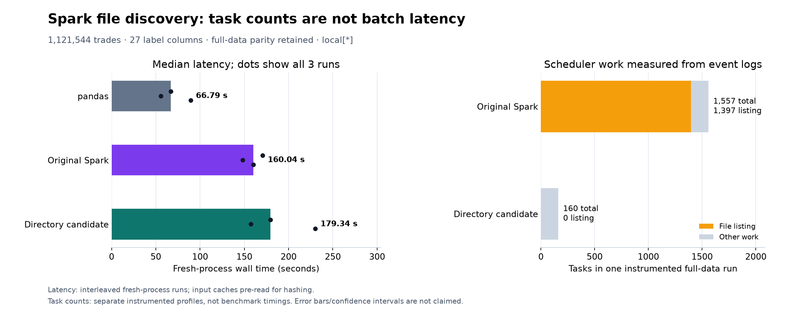

# Case study: fewer tasks did not mean faster labels

**Decision: retain the original reader as the default.** The directory-read
candidate eliminated 1,397 listing tasks and preserved full label parity, but
its observed median was 179.34 s versus 160.04 s for the frozen original Spark
control. That is 12.1% longer in this experiment. The candidate is retained at
commit `ddb26e4` with its evidence; no latency speedup is claimed.

The first port established full-data parity, then measured a slower local batch
result for Spark than pandas. This extension investigates one concrete source of
overhead, preserves the correctness gate, and measures the change against a frozen
Spark control. It changes the Spark reader only; the pandas code, input files,
research outputs, pricing, joins, volatility, and no-lookahead rules are preserved.

## Start with the execution plan and actual jobs

The baseline was captured before editing the reader, using the label engine at
`819cfdf`. `spark.profile` saves `explain(mode="formatted")` plans and aggregates
Spark listener event logs, the event stream used by the Spark UI/History Server.
The committed artifacts are plans and metric summaries, not a live UI screenshot.
Raw event logs and labeled output live only in automatically removed temporary
directories. Profiling runs are separate from performance trials.

The baseline profile processed both hourly series (1,121,544 labels):

| Observation | Baseline |
|---|---:|
| Total completed tasks | 1,557 |
| Distributed file-listing tasks | 1,397 |
| File-listing jobs | 2 |
| Combined wall time of those two listing jobs | 15.065 s |

The two job descriptions explicitly identify listings for 704 BTC and 693 ETH
paths. Listing accounts for 89.7% of the **task count**, not 89.7% of runtime.
The SQL plans also show four `ArrowEvalPython` nodes per series and substantial
join/aggregation work. Those operators are unchanged in this experiment.

The saved plans are pre-action formatted plans with adaptive execution enabled;
operator counts are not runtime scan counts. The separate listing jobs occur
while constructing the reader and are visible in the listener metrics. Reading
the final label DataFrame plan alone would miss this overhead.

## Change the input path strategy

Before, Spark received one input root for every event file:

```python
session.read.schema(TRADE_SCHEMA).parquet(*event_file_paths)
```

The flat-directory candidate at `ddb26e4` gives it one root and a series-name filter:

```python
session.read.schema(TRADE_SCHEMA).option(
    "pathGlobFilter", f"{series}-*.parquet"
).parquet(str(backfill / "trades"))
```

Spark's default parallel-discovery threshold is 32 input paths. A directory root
avoids launching a distributed listing job for each large list of event paths.
Files still have to be discovered on the driver; metadata I/O does not vanish.
The threshold itself is not changed. This targets the audited flat local backfill,
not every storage layout or a large remote object-store prefix.

The reader retains its typed schema, empty-input handling, and conflicting-duplicate
guard. A nested directory triggers the original explicit-path fallback to preserve
pandas' top-level glob semantics. Regression cases verify that an unrelated,
corrupt other-series file is never opened and nested trades are not added.

References: [Spark discovery threshold](https://spark.apache.org/docs/4.0.1/sql-performance-tuning.html),
[pathGlobFilter and recursive lookup](https://spark.apache.org/docs/4.0.1/sql-data-sources-generic-options.html#path-glob-filter).

## Correctness and comparison protocol

The existing full-data pytest gate must pass without changing its exact columns,
missing-value checks, or `rtol=1e-10, atol=1e-12` numeric tolerances. The sample,
ingestion, pricing, and future-candle mutation cases are also retained.

The recorded run archived baseline commit `819cfdf` into a temporary snapshot on
the same repository filesystem and compared it with candidate code at `ddb26e4`.
All workers used the same isolated Python environment and unchanged pandas
reference code, with each worker's checkout prepended to its Python import path.
Snapshot creation and input hashing happened outside the timed interval. The
`--candidate-ref` option now permits replaying the frozen candidate after the
default reader has been restored.

The predeclared sequence is **pandas, baseline Spark, optimized Spark, optimized
Spark, pandas, baseline Spark, baseline Spark, optimized Spark, pandas**. Each
variant has three fresh processes. No JVM or DataFrame cache is reused, and no
trial is discarded. Both Spark variants retain the same `local[*]` session
settings, validation, Arrow CDF, Snappy compression, and native output layout.
All label columns are materialized through Parquet writes on Linux disk.

Inputs are pre-read for hashing, OS caches are not flushed, and this remains a
shared laptop with uncontrolled background activity and thermals. Raw timings,
commands, source/input hashes, resource settings, and output checks are retained.
Three trials provide a descriptive comparison, not a confidence interval.

From the repository in WSL, after the isolated environment is installed:

```bash
/opt/asl-spark/venv/bin/python -B -m pytest tests/test_spark_parity.py \
  -m spark_full --spark-full-data --spark-backfill data/backfill -q -s -p no:cacheprovider
/opt/asl-spark/venv/bin/python -B -m spark.benchmark run \
  --backfill data/backfill --baseline-ref 819cfdf --candidate-ref ddb26e4
```

`--label` names a profile; it does not select an implementation. To reproduce the
baseline profile, use a separate checkout at `819cfdf`, copy the current
`spark/profile.py` instrumentation into it, and pass the original backfill's absolute
path. Keep the original working directory and research data intact. The controlled
benchmark's source-ref options perform their own temporary snapshots automatically.
To profile the candidate, run `spark.profile` from a separate checkout at `ddb26e4`;
running it from the current checkout profiles the retained original default.

## Verification before timing

The directory candidate passed:

```text
Sample/ingestion/no-lookahead checks: 27 passed, 2 deselected in 319.70s
Full-data parity: 2 passed, 14 deselected in 641.48s
KXBTC: 1,010,733 rows × 27 columns — PASS
KXETH:   110,811 rows × 27 columns — PASS
```

The numeric error bounds matched the original port: settlement markouts were
exact, and the largest horizon-markout difference was 5.6976646e-13 dollars per
contract. Test durations are correctness-run durations, not engine benchmarks.

After restoring the original default, the same full-data command passed again:
`2 passed, 14 deselected in 256.62s`, covering all 1,121,544 rows and 27 columns.

## Task-metric result

| Metric | Original | Optimized |
|---|---:|---:|
| Total completed tasks | 1,557 | 160 |
| Listing tasks | 1,397 | 0 |
| Listing jobs | 2 | 0 |
| Input bytes reported by task metrics | 125,421,818 | 125,421,818 |
| Shuffle read bytes | 208,483,032 | 208,483,032 |
| Shuffle write bytes | 206,902,530 | 206,902,530 |

That is an observed **89.7% reduction in scheduled tasks**. Input and shuffle
metrics stayed identical; the formatted SQL operator counts stayed identical,
including four Arrow evaluation nodes per series. The change removes the two
metadata-listing jobs without changing the label query. It does not eliminate
the other sources of Spark overhead or establish a proportional latency gain.

- [Original plan and metrics](profiles/20261122T001655Z-baseline/summary.json)
- [Optimized plan and metrics](profiles/20261122T003850Z-optimized/summary.json)

## Controlled latency result

All nine predeclared trials completed, each with the full 1,121,544-row output
and 27-column schema validated. Input and source hashes matched after the run.
The local machine, storage locations, package versions, session settings, and
exact commands are in the [raw receipt](benchmarks/20261122T004456Z/results.json).
The run was completed November 21, 2026, Eastern time (November 22 UTC).

| Variant | Run 1 (s) | Run 2 (s) | Run 3 (s) | Median (s) |
|---|---:|---:|---:|---:|
| pandas | 66.792785 | 55.685871 | 89.488644 | **66.792785** |
| Original Spark control (`819cfdf`) | 170.676361 | 148.054907 | 160.036146 | **160.036146** |
| Directory candidate (`ddb26e4`) | 179.344243 | 157.455167 | 230.287301 | **179.344243** |

The candidate's median was **12.0648% longer** than the original Spark control.
Its task count was **89.7238% lower**. These are different measurements: discovery
work moved to the driver, while the input bytes, shuffle bytes, and label query
stayed the same. This experiment does not isolate which driver, filesystem,
startup, or scheduling effects account for the latency difference.

The tool transport connection reset during candidate trial 3. The OS benchmark
process continued, its receipts survived, and the original timer recorded the
completed trial. That measurement was retained. The connection reset is not an
established explanation for the high timing. No retry or discarded trial was
used to improve the result. The shared-laptop/caching limitations above apply.



The graph shows medians and every raw timing point. Task counts come from separate
instrumented runs; they are not durations or confidence intervals. The original
November 19 benchmark is retained in the main port documentation and is not used
as the control for this experiment.

## Keep the measured decision in the code

The default `spark/ingestion.py` was restored to the original `819cfdf` version;
its source hash matches the original control recorded in the receipt. The two
new series-isolation/nested-directory regression tests remain. The candidate and
its plans remain reproducible from `ddb26e4`, and the benchmark can freeze both
source revisions without switching the user's working branch.

This is a negative optimization result, not a failed parity result. The label
values and research findings stayed unchanged. The lesson is to verify scheduler
improvements with end-to-end measurements before selecting a default.

### Recreate the figure

Matplotlib is an optional isolated plotting dependency, separate from both
benchmark environments. The committed PNG and SVG were rendered with Matplotlib
3.11.2. After creating `/opt/asl-spark/plot-venv`, install
`spark/figures/requirements.txt` there and run:

```bash
/opt/asl-spark/plot-venv/bin/python -B -m spark.render_results \
  --results spark/benchmarks/20261122T004456Z/results.json \
  --before-profile spark/profiles/20261122T001655Z-baseline/summary.json \
  --after-profile spark/profiles/20261122T003850Z-optimized/summary.json
```

### Interview explanation

“I found 1,397 metadata-listing tasks in Spark's event metrics and tested a
directory-filtered reader. Full-data parity still passed, and scheduled tasks
fell by 89.7%. But interleaved runs against frozen controls showed a worse local
median, so I kept the original default and documented the tradeoff.”
